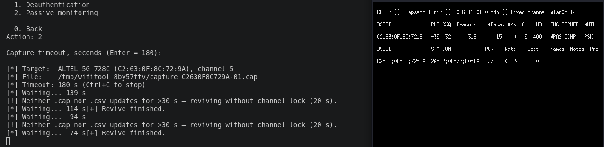
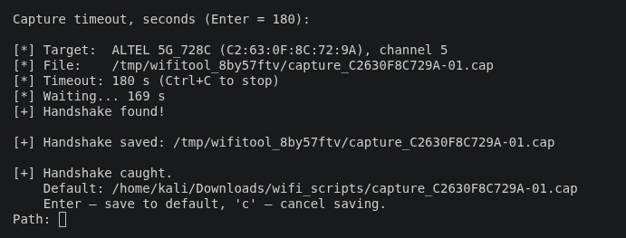

# WiFi Tool

**English** · [Русский](README.ru.md)

A menu-driven Wi-Fi auditing toolkit: scan networks, capture WPA/WPA2
handshakes (airodump-ng + aireplay-ng, or hcxdumptool), crack them with
hashcat, and run an Evil Twin (rogue AP + captive portal / sniffing).

> ⚠️ **For authorized testing of networks you own or have explicit permission
> to test.** Attacking others' networks is illegal.

The interface is available in **English (default) and Russian**; the choice is
saved and can be changed anytime from the menu (item 8).

---

## Screenshots

<p align="center">
  <br>
  <em>Live handshake capture: the tool's progress (left) next to the airodump
  window (right); the watchdog revives the adapter when the driver stalls.</em>
</p>

<p align="center">
  <br>
  <em>A WPA2 handshake caught and saved.</em>
</p>

---

## Requirements

- Linux with root (`sudo`), a Wi-Fi adapter that supports **monitor mode**
  (and, for Evil Twin, **AP mode**).
- A terminal emulator (`xterm`, `gnome-terminal`, `konsole`, …) for the live
  capture/attack windows.
- External tools, by feature:

  | Feature | Tools |
  |---|---|
  | Scan / handshake capture | `iw`, `ip`, `airodump-ng`, `aireplay-ng`, `aircrack-ng` |
  | hcxdumptool capture | `hcxdumptool`, `hcxpcapngtool` (hcxtools), `timeout` |
  | Cracking | `hashcat`, `hcxpcapngtool`, `wget` (for rockyou) |
  | Evil Twin | `hostapd`, `dnsmasq`, `iptables` (+ `bettercap`, `beef-xss`, `mdk4` for some modes) |

On Debian/Kali/Ubuntu, most come from:

```bash
sudo apt install aircrack-ng hcxtools hcxdumptool hashcat \
                 hostapd dnsmasq iptables xterm
```

There are **no third-party Python packages** (standard library only), so
there is nothing to `pip install`. The external CLI tools above are not
installed automatically; **menu item 7 (Dependencies)** shows a status table
of every tool and can install the missing ones for you via `apt` (with
confirmation). On a non-apt distro it lists the packages to install manually.

## Run

```bash
sudo python3 main.py
```

On the first run it asks for a language, then shows the main menu.

## Main menu

```
Adapter:
  1. Enable monitor mode
  2. Enable managed mode
Capture:
  3. Network analysis (deauth capture)   — airodump + deauth, catch a handshake
  4. Handshake capture (hcxdumptool)      — hcxdumptool, hashcat-ready .hc22000
Cracking:
  5. Password cracking                    — hashcat sessions over .cap/.hc22000
Attacks:
  6. Evil Twin                            — rogue AP: AP / captive portal / sniffing
  0. Change adapter   7. Dependencies   8. Language   9. Exit
```

## Features

### 3. Network analysis (handshake capture)
Scans 2.4 + 5 GHz, you pick a target, then it opens an airodump capture window
and (optionally) a deauth window that keeps kicking clients until a handshake is
caught. A background watchdog revives the adapter if the driver stalls. The
caught `.cap` can be saved for cracking.

### 4. Handshake capture (hcxdumptool)
Runs `timeout <dur> hcxdumptool -i <iface> -w capture.pcapng --rds=1` a chosen
number of times. Each run is validated with `hcxpcapngtool`, which only writes
hashcat-valid EAPOL/PMKID hashes — so a network is listed only if its hash is
actually crackable. Networks are de-duplicated by BSSID across runs; new ones
are saved as ready-to-crack `.hc22000` files.

### 5. Password cracking (hashcat)
Manage cap files (add `.cap` — auto-converted — or a ready `.hc22000`),
wordlists (with optional rockyou download), and resumable hashcat sessions.
Recovered passwords are detected from hashcat output (default `-m 22000`
format, the old 2500 layout, and `--outfile-format 2`) and listed per network.

### 6. Evil Twin
A mode submenu, airgeddon-style. Common steps: scan + target, pick deauth
method (`aireplay-ng` or `mdk4`), and 1 or 2 adapters — with one adapter a
virtual monitor interface is created on the same radio for the deauth, with two
adapters the second one attacks independently.

- **Just AP** — open twin + deauth, no portal/sniffing.
- **Captive portal** — password portal; HTTP is redirected to it; the entered
  password can be validated against a captured handshake. Pick the built-in
  `default` page or **add your own HTML** (a `.html` file or a folder with
  `index.html`) to match a specific operator (e.g. Altel). Template contract:
  placeholders `{{ESSID}}`/`{{ERROR}}`; the form POSTs a `password` field;
  assets next to `index.html` are served. Captured passwords are saved to
  `evil_twin_data/captured.txt`.
- **Sniffing / +sslstrip2 / +BeEF** — MITM: the victim gets real internet via a
  chosen **uplink** (NAT) while traffic is inspected with bettercap (plus
  sslstrip/hstshijack or a BeEF hook). These need an internet uplink and the
  extra tools above.

On Ctrl+C everything is stopped and the network/iptables/adapter modes are
restored.

**If the captive portal doesn't pop up on the phone:** the twin AP is always
open (that's normal; airgeddon is the same); make sure port 53 is free
(`sudo systemctl stop systemd-resolved`) and that the phone's **Private DNS**
is off (it bypasses the rogue DNS).

## Project layout

```
main.py                 entry point
wifitool/
  i18n.py        language catalog (EN/RU) + persistence
  constants.py   settings, paths, tool lists, watchdog params
  system.py      root/tool checks, subprocess wrapper
  terminal.py    terminal windows, process groups, shell quoting
  iface.py       adapter: modes, phy, channel, MAC, selection
  ui.py          input/output helpers
  hashfile.py    .hc22000 / hashcat out-file parsing
  netscan.py     airodump scanning + CSV parsing
  capture.py     handshake capture + deauth + watchdog
  hcx.py         hcxdumptool capture
  cracker.py     hashcat cracking
  evil_twin.py   rogue AP + captive portal / sniffing
  portal_server.py    captive-portal web server (separate process)
  portal_templates/   built-in portal pages
  menu.py        main-menu action registry (FEATURES)
  app.py         main loop
```

Data lives in `cracker_data/` and `evil_twin_data/` (git-ignored); the language
choice in `~/.config/wifitool/config.json`.

## Tests

Unit tests cover the pure parsers (airodump CSV, `.hc22000`, hashcat output) —
no root, adapter or Wi-Fi needed. Sample data lives in `tests/fixtures/`.

```bash
pip install -r requirements-dev.txt   # installs pytest
pytest
```

## Adding a new feature

1. Create `wifitool/<feature>.py` with `def <feature>_flow(interface): ...`
   (reuse `terminal`, `iface`, `ui`, `constants`, `hashfile`).
2. Add its labels to `i18n.MESSAGES` and register one line in
   `wifitool/menu.py`:

   ```python
   Feature("7", "grp.attacks", "feat.myfeature", myfeature_flow, needs_monitor=True)
   ```

The menu builds itself from `FEATURES` — `main.py`/`app.py` stay untouched.
