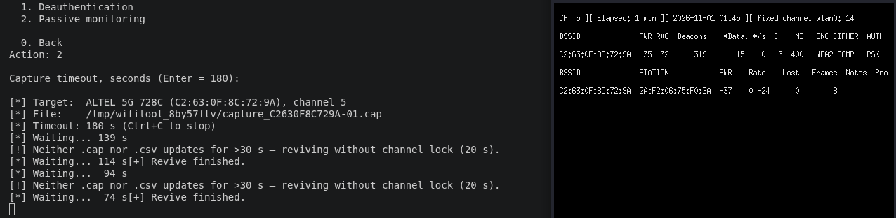
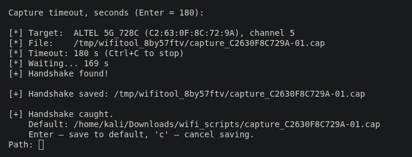

# WiFi Tool

[English](README.md) · **Русский**

Набор утилит для аудита Wi-Fi с меню: сканирование сетей, захват WPA/WPA2
handshake (airodump-ng + aireplay-ng или hcxdumptool), взлом через hashcat и
Evil Twin (поддельная точка + captive-портал / сниффинг).

> ⚠️ **Только для легального тестирования своих сетей или сетей, на которые
> есть явное разрешение.** Атаковать чужие сети незаконно.

Интерфейс доступен на **английском (по умолчанию) и русском**; выбор
сохраняется и меняется в любой момент из меню (пункт 8).

---

## Скриншоты

<p align="center">
  <br>
  <em>Захват handshake вживую: прогресс скрипта (слева) рядом с окном airodump
  (справа); watchdog оживляет адаптер, когда драйвер зависает.</em>
</p>

<p align="center">
  <br>
  <em>WPA2 handshake пойман и сохранён.</em>
</p>

---

## Требования

- Linux с правами root (`sudo`), Wi-Fi адаптер с поддержкой **monitor mode**
  (а для Evil Twin — и **AP mode**).
- Эмулятор терминала (`xterm`, `gnome-terminal`, `konsole`, …) для окон
  захвата/атаки.
- Внешние утилиты по функциям:

  | Функция | Утилиты |
  |---|---|
  | Скан / захват handshake | `iw`, `ip`, `airodump-ng`, `aireplay-ng`, `aircrack-ng` |
  | Захват hcxdumptool | `hcxdumptool`, `hcxpcapngtool` (hcxtools), `timeout` |
  | Взлом | `hashcat`, `hcxpcapngtool`, `wget` (для rockyou) |
  | Evil Twin | `hostapd`, `dnsmasq`, `iptables` (+ `bettercap`, `beef-xss`, `mdk4` для части режимов) |

На Debian/Kali/Ubuntu большинство ставится так:

```bash
sudo apt install aircrack-ng hcxtools hcxdumptool hashcat \
                 hostapd dnsmasq iptables xterm
```

**Сторонних Python-пакетов нет** (только стандартная библиотека) — `pip
install` не нужен. Внешние CLI-утилиты сами не ставятся; **пункт меню 7
(Зависимости)** показывает таблицу «есть/нет» по каждой утилите и может
доустановить недостающее через `apt` (с подтверждением). На дистрибутиве без
apt он покажет список пакетов для ручной установки.

## Запуск

```bash
sudo python3 main.py
```

При первом запуске спросит язык, затем покажет главное меню.

## Главное меню

```
Адаптер:
  1. Включить режим monitor
  2. Включить режим managed
Захват:
  3. Анализ сети (деаутентификация)      — airodump + deauth, ловим handshake
  4. Захват handshake (hcxdumptool)       — hcxdumptool, готовый .hc22000
Взлом:
  5. Взлом пароля                         — сессии hashcat по .cap/.hc22000
Атаки:
  6. Evil Twin                            — двойник: AP / портал / сниффинг
  0. Сменить адаптер   7. Зависимости   8. Язык   9. Выход
```

## Функции

### 3. Анализ сети (захват handshake)
Сканирует 2.4 + 5 ГГц, вы выбираете цель, затем открывается окно захвата
airodump и (по желанию) окно деаутентификации, которое выбивает клиентов, пока
не пойман handshake. Фоновый watchdog оживляет адаптер, если драйвер завис.
Пойманный `.cap` можно сохранить для взлома.

### 4. Захват handshake (hcxdumptool)
Запускает `timeout <сек> hcxdumptool -i <iface> -w capture.pcapng --rds=1`
заданное число раз. Каждый прогон проверяется `hcxpcapngtool`, который пишет
только валидные для hashcat EAPOL/PMKID — поэтому сеть в списке означает, что её
хэш реально перебираем. Сети дедуплицируются по BSSID между прогонами; новые
сохраняются готовыми `.hc22000`.

### 5. Взлом пароля (hashcat)
Управление cap-файлами (добавить `.cap` — конвертируется автоматически — или
готовый `.hc22000`), словарями (с опциональной загрузкой rockyou) и
возобновляемыми сессиями hashcat. Подобранные пароли распознаются из вывода
hashcat (дефолтный формат `-m 22000`, старый 2500 и `--outfile-format 2`) и
показываются по сетям.

### 6. Evil Twin
Подменю режимов, как в airgeddon. Общие шаги: скан + цель, выбор метода деаута
(`aireplay-ng` или `mdk4`) и числа адаптеров — с 1 адаптером на том же радио
создаётся виртуальный monitor-интерфейс для деаута, с 2 адаптерами второй
атакует независимо.

- **Just AP** — открытый двойник + деаут, без портала и сниффинга.
- **Captive portal** — портал с вводом пароля; HTTP заворачивается на него;
  введённый пароль можно сверять с пойманным handshake. Выбор встроенного
  `default` или **свой HTML** (`.html` файл или папка с `index.html`) под
  конкретного оператора (например, Altel). Контракт шаблона: плейсхолдеры
  `{{ESSID}}`/`{{ERROR}}`; форма шлёт POST с полем `password`; статика рядом с
  `index.html` отдаётся. Пойманные пароли — в `evil_twin_data/captured.txt`.
- **Sniffing / +sslstrip2 / +BeEF** — MITM: жертве даётся реальный интернет
  через выбранный **аплинк** (NAT), трафик анализируется bettercap (плюс
  sslstrip/hstshijack или хук BeEF). Нужен аплинк с интернетом и доп. утилиты
  выше.

По Ctrl+C всё останавливается, а сеть/iptables/режимы адаптеров
восстанавливаются.

**Если на телефоне не всплывает портал:** двойник всегда открытая сеть (это
нормально, в airgeddon так же); убедитесь, что порт 53 свободен
(`sudo systemctl stop systemd-resolved`) и что на телефоне выключен
**Приватный DNS** (он идёт мимо нашего DNS).

## Структура проекта

```
main.py                 точка входа
wifitool/
  i18n.py        каталог строк (EN/RU) + сохранение выбора
  constants.py   настройки, пути, списки утилит, параметры watchdog
  system.py      проверки root/утилит, обёртка subprocess
  terminal.py    окна терминала, группы процессов, экранирование shell
  iface.py       адаптер: режимы, phy, канал, MAC, выбор
  ui.py          хелперы ввода/вывода
  hashfile.py    разбор .hc22000 / out-файлов hashcat
  netscan.py     сканирование airodump + разбор CSV
  capture.py     захват handshake + деаут + watchdog
  hcx.py         захват hcxdumptool
  cracker.py     взлом hashcat
  evil_twin.py   двойник + captive-портал / сниффинг
  portal_server.py    веб-сервер портала (отдельный процесс)
  portal_templates/   встроенные страницы портала
  menu.py        реестр действий меню (FEATURES)
  app.py         главный цикл
```

Данные — в `cracker_data/` и `evil_twin_data/` (в .gitignore); выбор языка — в
`~/.config/wifitool/config.json`.

## Тесты

Юнит-тесты покрывают чистые парсеры (CSV airodump, `.hc22000`, вывод hashcat) —
без root, адаптера и Wi-Fi. Образцы данных — в `tests/fixtures/`.

```bash
pip install -r requirements-dev.txt   # поставит pytest
pytest
```

## Как добавить новую функцию

1. Создайте `wifitool/<feature>.py` с `def <feature>_flow(interface): ...`
   (используя `terminal`, `iface`, `ui`, `constants`, `hashfile`).
2. Добавьте строки в `i18n.MESSAGES` и одну строку в `wifitool/menu.py`:

   ```python
   Feature("7", "grp.attacks", "feat.myfeature", myfeature_flow, needs_monitor=True)
   ```

Меню строится из `FEATURES` само — `main.py`/`app.py` трогать не нужно.
